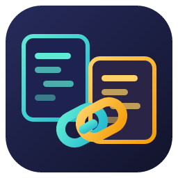
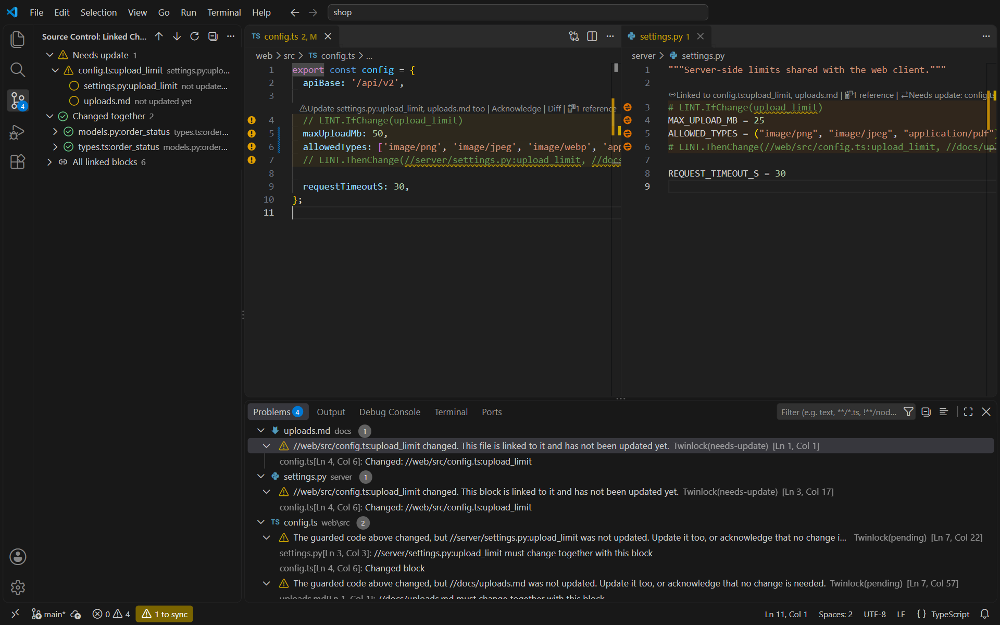
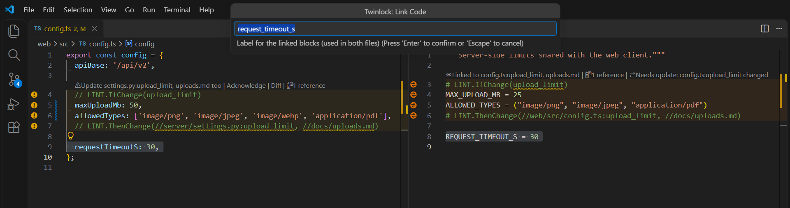
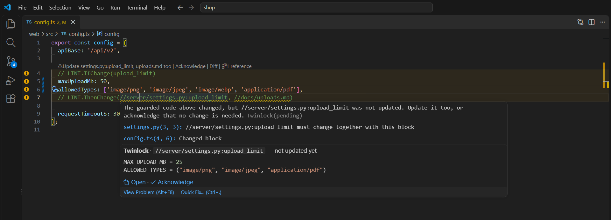
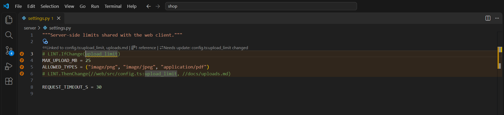
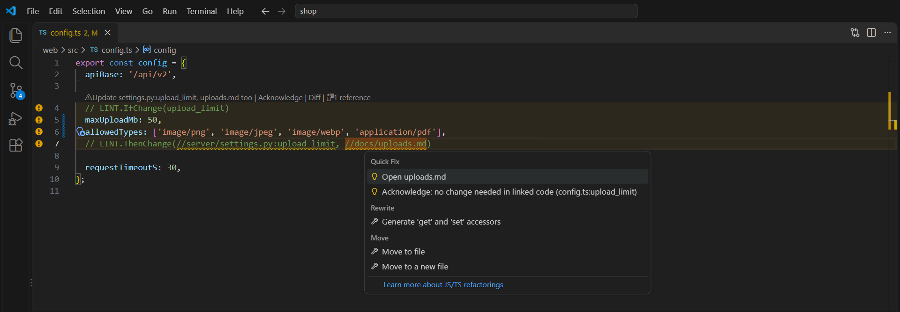
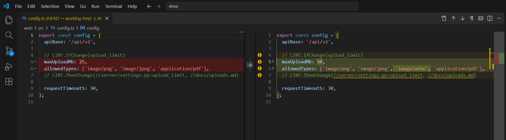

<p align="center">
  
</p>

<h1 align="center">Twinlock</h1>

<p align="center">
  <b>함께 바뀌어야 하는 코드를, 파일·폴더·언어를 넘어 항상 동기화된 상태로.</b><br>
  VS Code를 위한 실시간 <code>LINT.IfChange</code> / <code>LINT.ThenChange</code>
</p>

<p align="center"><a href="README.md">English</a> · 한국어</p>

<p align="center">
  
</p>

모든 코드베이스에는 여러 곳에 동시에 존재하는 "사실"이 있습니다. 클라이언트와 서버의 업로드 용량 제한, TypeScript와 Python에 각각 정의된 enum, 인코더와 디코더, 상수와 그 값을 설명하는 문서 같은 것들입니다. 보통은 `// server/settings.py와 같이 수정할 것` 같은 주석으로 지키려 하지만, 누군가는 결국 그 주석을 놓칩니다.

**Twinlock은 그런 주석을, 타이핑하는 순간 에디터가 지켜 주는 계약으로 바꿉니다.** 한 번 표시해 두면, 한쪽만 바뀌는 순간 양쪽 모두에 표시가 뜹니다. 에디터, Problems 패널, 소스 제어 사이드바, 상태 표시줄에서 모두 볼 수 있고, 커밋하거나 CI를 돌릴 필요도 없습니다.

```ts
// web/src/config.ts
// LINT.IfChange(upload_limit)
maxUploadMb: 25,
// LINT.ThenChange(//server/settings.py:upload_limit, //docs/uploads.md)
```

```python
# server/settings.py
# LINT.IfChange(upload_limit)
MAX_UPLOAD_MB = 25
# LINT.ThenChange(//web/src/config.ts:upload_limit)
```

문법은 Google이 오랫동안 써 온 `LINT.IfChange` / `LINT.ThenChange` 규칙 그대로입니다. Twinlock은 이 문법을 모든 언어에서 읽기 때문에 이미 작성된 주석도 바로 동작하고, 새로 추가하는 주석도 [ifttt-lint](https://github.com/simonepri/ifttt-lint) 같은 CLI 검사기와 호환됩니다. 원하면 CI 검사도 함께 둘 수 있습니다.

## 주요 특징

| | |
|---|---|
| ⚡ **실시간** | 저장하지 않은 편집도 즉시 검사합니다. 커밋, 푸시, CI 모두 필요 없습니다. |
| 🔁 **양방향 표시** | 수정한 파일에는 "상대편도 고치세요", 상대 파일에는 "업데이트가 필요합니다"가 뜹니다. |
| 🌐 **모든 언어** | `//`, `#`, `--`, `/* */`, `<!-- -->`, `{# #}`, `(* *)`, `REM` 등 20가지가 넘는 주석 형식을 인식합니다. |
| 🧭 **탐색** | 대상 위에서 Ctrl/Cmd+클릭, 마우스를 올리면 연결된 코드 미리보기, 참조 찾기, 다음 동기화 지점으로 이동을 지원합니다. |
| 🪄 **단축키 한 번으로 연결** | 코드를 선택하고 <kbd>Ctrl</kbd>+<kbd>Alt</kbd>+<kbd>L</kbd>, 짝이 되는 코드를 선택하고 다시 한 번. 각 파일의 주석 문법에 맞춰 양쪽에 디렉티브를 넣어 줍니다. |
| 🧠 **정확함** | 감싼 줄만 검사합니다. 블록 바깥, 디렉티브 줄, 줄바꿈 문자(CRLF/LF)만 바뀐 경우에는 오탐이 없습니다. |
| 🗂️ **Git 인식** | 기본은 `HEAD`와 비교하고, `origin/main`과 비교해 브랜치 전체를 검토할 수도 있습니다. `.gitignore`와 중첩 저장소를 존중합니다. |
| 🚀 **빠름** | 파일 4,500개·연결 블록 3,000개 저장소를 약 5초에 인덱싱하고, 이후 편집마다 약 0.2초에 다시 검사합니다. |

## 빠른 시작

1. **Twinlock**을 설치하고 폴더를 엽니다.
2. 함께 바뀌어야 하는 줄을 선택하고 <kbd>Ctrl</kbd>+<kbd>Alt</kbd>+<kbd>L</kbd>(macOS는 <kbd>Cmd</kbd>+<kbd>Alt</kbd>+<kbd>L</kbd>)을 누르거나, 우클릭 → **Link Selection…**을 선택합니다.
3. 아무 파일, 아무 언어에서 짝이 되는 코드를 선택하고 단축키를 한 번 더 누릅니다.
4. 제안된 라벨을 확인하면 연결이 끝납니다.

<p align="center">
  
</p>

이제 한쪽을 바꿔 보세요. 반대쪽에 바로 표시가 뜨고, 양쪽을 모두 고치면 경고가 저절로 사라집니다.

## 기능

### 연결된 코드가 어긋나는 순간을 바로 알 수 있습니다

감싼 코드가 바뀌면, 함께 바뀌지 **않은** 연결 대상을 모두 보고합니다. 블록에 색이 칠해지고, CodeLens가 무엇이 남았는지 알려 주며, 아직 수정되지 않은 대상마다 밑줄이 그어집니다. Problems 패널에는 **양쪽 파일 모두**에 할 일이 표시되므로, 어느 파일을 먼저 열어도 상관없습니다.

### 파일을 떠나지 않고 상대편 코드 확인

대상 위에 마우스를 올리면 연결된 코드 미리보기와 업데이트 여부가 보이고, 클릭 한 번으로 열거나 승인할 수 있습니다. <kbd>F12</kbd> 또는 <kbd>Ctrl</kbd>+클릭으로 해당 라벨 블록으로 바로 이동합니다.

<p align="center"></p>

### 상대 파일도 알고 있습니다

연결된 파일을 열면 고쳐야 할 블록이 이미 강조되어 있습니다: *"Needs update: config.ts:upload_limit changed"*. CodeLens를 클릭하면 상대편에서 무엇이 바뀌었는지 diff로 보여 줍니다.

<p align="center"></p>

### 상황별 빠른 수정

대상 열기, 변경 내용 보기, 또는 "변경할 필요 없음"으로 **승인(Acknowledge)**할 수 있습니다. 승인은 해당 블록 내용이 다시 바뀌기 전까지만 유지됩니다.

<p align="center"></p>

### 무엇이 바뀌었는지 정확히

**Diff**(CodeLens, 호버, 트리에서 실행)는 파일을 기준점과 나란히 비교해 보여 주므로, 변경 내용을 그대로 옮겨 적기 쉽습니다.

<p align="center"></p>

### 한눈에 보기

- **Linked Changes 뷰**(소스 제어 사이드바): *Needs update*, *Broken links*, *Changed together*, *All linked blocks* 그룹과 대기 개수 배지를 보여 줍니다. 대기 중인 블록은 펼쳐진 상태라, 아직 고치지 않은 대상이 바로 보입니다.
- **상태 표시줄**: `⚠ 2 to sync` 또는 `⛔ 1 broken link`. 클릭하면 뷰가 열립니다.
- **Go to Next / Previous Code to Sync**: 손봐야 할 위치를 양쪽 모두 순서대로 이동합니다.
- **참조 찾기**(<kbd>Shift</kbd>+<kbd>F12</kbd>): 이 블록을 가리키는 모든 곳을 보여 줍니다.
- **깨진 링크는 오류로 표시**: 없는 파일이나 라벨, 짝 없는 `ThenChange`, 닫히지 않은 블록, 중복 라벨을 해당 위치에 정확히 표시합니다.

## 문법

```text
<주석> LINT.IfChange                     라벨 없는 감시 블록
<주석> LINT.IfChange(label)              다른 파일에서 참조할 수 있는 감시 블록
   ...감시할 코드...
<주석> LINT.ThenChange(대상, 대상…)      블록을 닫고 함께 바뀌어야 할 대상을 나열
```

| 대상 | 의미 |
|---|---|
| `//path/to/file.ts` | 프로젝트 루트 기준 파일 전체. 파일 어디가 바뀌어도 인정됩니다. |
| `//path/to/file.ts:label` | 그 파일의 `LINT.IfChange(label)` 블록만 |
| `:label` | 같은 파일 안의 라벨 블록(예: 인코더와 디코더) |
| `./file.ts`, `../dir/file.ts` | 현재 파일 기준 상대 경로 |
| `file.ts`, `dir/file.ts` | 현재 파일 기준으로 먼저 찾고, 없으면 프로젝트 루트 기준으로 찾습니다. |

**프로젝트 루트**는 파일이 속한 git 저장소입니다. 중첩 저장소와 서브모듈은 각자의 루트를 쓰고, git이 없으면 워크스페이스 폴더가 루트입니다.

- **라벨**은 영문자로 시작하고 영문자, 숫자, `_`, `-`, `.`만 쓸 수 있으며, 한 파일 안에서 유일해야 합니다.
- **대상이 여러 개**이면 쉼표로 구분합니다. 목록은 여러 주석 줄에 걸쳐 쓸 수 있습니다.
- **블록 중첩**을 지원하고, 각 블록은 독립적으로 검사됩니다.
- 디렉티브는 줄 맨 앞(주석 기호 뒤)에 와야 합니다. 닫는 괄호 뒤의 설명 문장은 무시됩니다.
- JSON, CSV, lock 파일처럼 **주석을 쓸 수 없는 파일**도 `LINT.ThenChange(//package.json)`처럼 **파일 전체 대상**으로는 쓸 수 있습니다.

## 변경 감지 방식

각 파일을 **기준점**과 비교하되, 두 디렉티브 **사이의 줄**만 봅니다.

| 상황 | 기준점 |
|---|---|
| git이 추적하는 파일 | `twinlock.baseRef`(기본값 `HEAD`) 시점의 내용. 저장 여부와 관계없이 커밋하지 않은 작업을 검사합니다. |
| 새로 만든(untracked) 파일 | 빈 내용. 파일 전체가 새 내용으로 취급됩니다. |
| git-ignore된 파일, git이 없는 폴더, 제한 모드 | 세션을 시작할 때의 내용. **Reset Session Baseline**으로 현재 디스크 내용을 새 기준점으로 삼을 수 있습니다. |

- ✅ 블록 **안의** 줄을 추가, 삭제, 수정하면 변경으로 봅니다.
- ❌ 블록 바깥의 줄이나 **디렉티브 줄만** 바꾼 경우(대상 추가, 라벨 변경 등)는 변경이 아닙니다.
- ❌ 기존 코드를 새 `IfChange`/`ThenChange`로 감싸기만 한 경우도 변경이 아닙니다.
- ❌ 줄바꿈 문자(CRLF↔LF)나 BOM만 바뀐 경우도 변경이 아닙니다.

`"twinlock.baseRef": "origin/main"`으로 설정하면 PR 리뷰처럼 브랜치 전체 변경을 검사합니다. 기본적으로 GitHub과 같은 merge base 기준으로 비교합니다.

## 명령어와 설정

명령어 전체 목록과 설정 표는 [영문 README](README.md#commands-and-shortcuts)에 정리되어 있습니다. 자주 쓰는 것만 추리면 다음과 같습니다.

- `Twinlock: Link Selection…` — <kbd>Ctrl</kbd>/<kbd>Cmd</kbd>+<kbd>Alt</kbd>+<kbd>L</kbd>
- `Twinlock: Acknowledge: No Linked Change Needed`
- `Twinlock: Go to Next Code to Sync`
- `twinlock.baseRef`, `twinlock.pendingSeverity`, `twinlock.directiveNamespace`, `twinlock.exclude`

## 지원 환경

Windows, macOS, Linux에서 동작하고, 멀티 루트 워크스페이스, 모노레포, 서브모듈, 중첩 저장소, 원격 환경(SSH/WSL/Dev Container), 제한 모드(이때는 git을 실행하지 않음)를 지원합니다. VS Code 1.85 이상이 필요하며 git은 선택 사항입니다.

## 라이선스

[MIT](LICENSE)
