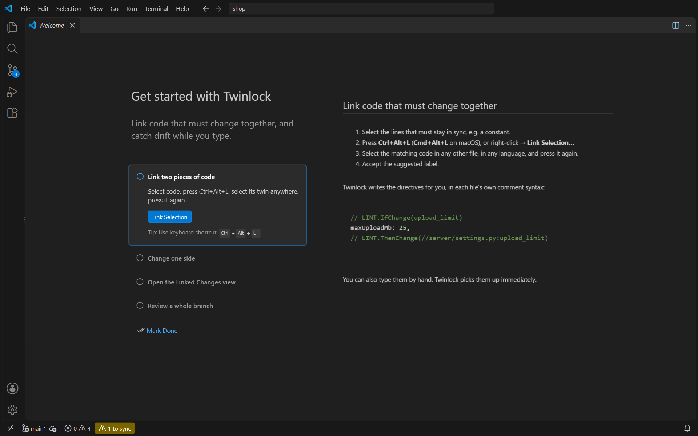

<p align="center">
  
</p>

<h1 align="center">Twinlock</h1>

<p align="center">
  <b>Keep linked code in sync — across files, folders and languages.</b><br>
  Real-time <code>LINT.IfChange</code> / <code>LINT.ThenChange</code> for Visual Studio Code.
</p>

<p align="center">
  
  
  
  <a href="README.ko.md"></a>
</p>

<p align="center">
  
</p>

Every codebase has facts that live in more than one place: an upload limit in the client **and** the server, an enum in TypeScript **and** Python, an encoder **and** its decoder, a constant **and** the docs that describe it. Most teams protect them with a comment such as `// keep in sync with server/settings.py`. Then somebody forgets to read it.

**Twinlock turns those comments into a contract that your editor enforces as you type.** Mark the code once, and the moment one side changes without the other, both sides light up: in the editor, in the Problems panel, in the Source Control sidebar and in the status bar. You don't have to commit or run CI first.

```ts
// web/src/config.ts
// LINT.IfChange(upload_limit)
maxUploadMb: 25,
// LINT.ThenChange(//server/settings.py:upload_limit, //docs/uploads.md)
```

```python
# server/settings.py
# LINT.IfChange(upload_limit)
MAX_UPLOAD_MB = 25
# LINT.ThenChange(//web/src/config.ts:upload_limit)
```

The syntax is Google's long-standing `LINT.IfChange` / `LINT.ThenChange` convention. Twinlock understands it in any language, so existing annotations work immediately, and anything you add stays compatible with CLI checkers such as [ifttt-lint](https://github.com/simonepri/ifttt-lint) if you also want a CI gate.

---

## Contents

- [Highlights](#highlights)
- [Quick start](#quick-start)
- [Features](#features)
- [Syntax reference](#syntax-reference)
- [How changes are detected](#how-changes-are-detected)
- [Commands and shortcuts](#commands-and-shortcuts)
- [Settings](#settings)
- [Environments](#environments)
- [FAQ and troubleshooting](#faq-and-troubleshooting)
- [Development](#development)

## Highlights

| | |
|---|---|
| ⚡ **Real-time** | Unsaved edits are checked instantly. No commit, push or CI run needed. |
| 🔁 **Both sides** | The file you changed says *"update the other side too"*. The other file says *"this needs updating"*. |
| 🌐 **Any language** | Works with 20+ comment styles: `//`, `#`, `--`, `/* */`, `<!-- -->`, `{# #}`, `(* *)`, `REM` and more. |
| 🧭 **Navigation** | Ctrl/Cmd+Click a target, hover for a live preview of the linked code, Find All References, and jump between pending items. |
| 🪄 **One-shortcut linking** | Select code, press <kbd>Ctrl</kbd>+<kbd>Alt</kbd>+<kbd>L</kbd>, select its twin, press it again. Twinlock writes both directives for you, in each file's comment syntax. |
| 🧠 **Precise** | Only the guarded lines count. Edits around the block, to the directive lines, or to line endings never cause false alarms. |
| 🗂️ **Git-aware** | Compares against `HEAD` by default, or against `origin/main` to review a whole branch. Respects `.gitignore` and nested repositories. |
| 🚀 **Fast** | Indexes a 4,500-file repository with 3,000 linked blocks in about 5 s, then re-checks it in about 0.2 s per edit. |

## Quick start

1. Install **Twinlock** and open a folder.
2. Select the lines that must stay in sync and press <kbd>Ctrl</kbd>+<kbd>Alt</kbd>+<kbd>L</kbd> (<kbd>Cmd</kbd>+<kbd>Alt</kbd>+<kbd>L</kbd> on macOS), or right-click → **Link Selection…**
3. Select the matching code in any file, in any language, and press the shortcut again.
4. Accept the suggested label. Both blocks are now linked:

<p align="center">
  
</p>

Now change one side and watch the other light up. When both sides are updated, the warnings disappear on their own.

> **Tip:** You can also type the directives by hand. Twinlock picks them up as soon as they appear, including in unsaved files. For a guided tour, open **Help → Welcome → Get started with Twinlock**.

<details>
<summary>Show the guided tour</summary>
<p align="center"></p>
</details>

## Features

### Know the moment linked code drifts

When guarded code changes, Twinlock reports every linked target that has **not** changed with it. The block is tinted, the CodeLens explains what is missing, and each outdated target is underlined.

The Problems panel lists the obligation in **both** files, so it doesn't matter which one you open first.

### See what the other side looks like without leaving the file

Hover a target to preview the linked code, see whether it was updated, and open it or acknowledge it with one click. <kbd>F12</kbd> or <kbd>Ctrl</kbd>+Click jumps straight to the labeled block.

<p align="center">
  
</p>

### The other file knows too

Open the linked file and the block that needs work is already highlighted: *"Needs update: config.ts:upload_limit changed"*. Click the CodeLens to see exactly what changed on the other side.

<p align="center">
  
</p>

### Quick fixes for every situation

Open the target, see what changed, or **acknowledge** that no change is needed. An acknowledgement silences the warning only until the guarded code changes again.

<p align="center">
  
</p>

### See exactly what changed

**Diff** (CodeLens, hover or tree) opens the file next to its baseline, so you can copy the change across.

<p align="center">
  
</p>

### Everything at a glance

- **Linked Changes view** (Source Control sidebar): *Needs update*, *Broken links*, *Changed together* and *All linked blocks*, with a badge for pending items. Pending blocks are expanded, so their outdated targets are visible right away.
- **Status bar**: `⚠ 2 to sync`, or `⛔ 1 broken link`. Click it to open the view.
- **Go to Next / Previous Code to Sync** walks through every place that needs attention, on both sides.
- **Find All References** (<kbd>Shift</kbd>+<kbd>F12</kbd>) on a block lists everything that links to it.
- **Broken links are errors**: a missing file, a missing label, a `ThenChange` without an `IfChange`, an unclosed block or a duplicate label is reported precisely where it is written.

## Syntax reference

```text
<comment> LINT.IfChange                     guarded block without a label
<comment> LINT.IfChange(label)              guarded block that other files can reference
   ...guarded code...
<comment> LINT.ThenChange(target, target…)  closes the block and lists what must change with it
```

### Targets

| Target | Meaning |
|---|---|
| `//path/to/file.ts` | The whole file, relative to the project root. Any change to the file counts. |
| `//path/to/file.ts:label` | Only the `LINT.IfChange(label)` block in that file. |
| `:label` | A labeled block in the same file, such as an encoder and its decoder. |
| `./file.ts`, `../dir/file.ts` | Relative to the current file. |
| `file.ts`, `dir/file.ts` | Relative to the current file, then to the project root (see [`resolveBarePathsFromRoot`](#settings)). |

The **project root** is the git repository that contains the file (nested repositories and submodules use their own root). Outside git, it is the workspace folder.

### Rules

- **Labels** start with a letter and may contain letters, digits, `_`, `-` and `.` (`upload_limit`, `user-response`, `Payments.Result`). They must be unique within a file.
- **Multiple targets** are separated by commas. Long lists may span several comment lines:

  ```python
  # LINT.ThenChange(
  #     //web/src/config.ts:upload_limit,
  #     //docs/uploads.md,
  # )
  ```

- **Blocks may nest.** Each block is checked on its own.
- **Directives** must start their line, optionally after a comment marker. Text after the closing parenthesis is ignored, so `// LINT.IfChange(a) keep in sync with the API docs` is fine.
- **Comment styles** are recognised everywhere: `//`, `///`, `#`, `--`, `;`, `%`, `'`, `"`, `/* */`, ` * `, `<!-- -->`, `{{/* */}}`, `{{! }}`, `{# #}`, `{/* */}`, `<%# %>`, `@* *@`, `{- -}`, `(* *)`, `::` and `REM`.
- **Files that cannot hold comments** (JSON, CSV, lock files) can still be **whole-file targets**, e.g. `LINT.ThenChange(//package.json)`.

## How changes are detected

Twinlock compares each file with a **baseline** and looks only at the **guarded lines** between the two directives.

| Situation | Baseline |
|---|---|
| File tracked by git | Its content at [`twinlock.baseRef`](#settings) (default `HEAD`), so your uncommitted work, saved or not, is checked. |
| New, untracked file | Empty: everything in it counts as new. |
| Git-ignored file, a folder without git, or [Restricted Mode](#environments) | The content when the session started. Use **Reset Session Baseline** to accept what is on disk now. |

What counts as a change:

- ✅ Adding, removing or editing lines **inside** a block.
- ❌ Editing lines outside the block, or **only the directive lines** (for example adding a target or renaming a label).
- ❌ Wrapping existing code in a new `IfChange` / `ThenChange` pair.
- ❌ Changing only line endings (CRLF ↔ LF) or the byte-order mark.

| State | Meaning | Shown as |
|---|---|---|
| **Linked** | The guarded code is unchanged. | `🔗 Linked to …` CodeLens |
| **Needs update** | The guarded code changed, but a target did not. | Warning on both sides, tinted block, status bar |
| **In sync** | The guarded code and all its targets changed. | `✓ In sync with …` and a green gutter mark |
| **Acknowledged** | You confirmed that the targets don't need changes. This lasts until the block changes again. | `✓✓ Acknowledged` (click to undo) |
| **Broken** | A target file or label doesn't exist. | Error |

### Reviewing a whole branch

Set `"twinlock.baseRef": "origin/main"` to check everything your branch changed, like a pull-request review. With `twinlock.useMergeBase` (on by default), Twinlock compares against the merge base, as GitHub does. If the ref doesn't exist, Twinlock falls back to `HEAD` and logs a warning.

## Commands and shortcuts

| Command | Shortcut | Description |
|---|---|---|
| **Twinlock: Link Selection…** | <kbd>Ctrl</kbd>+<kbd>Alt</kbd>+<kbd>L</kbd> / <kbd>Cmd</kbd>+<kbd>Alt</kbd>+<kbd>L</kbd> | First press: remember the selection. Second press, on another selection: link the two. On an empty selection in another file: link that whole file. |
| **Twinlock: Link Selection to File…** | | Link the selection to a file you pick, as a whole or one of its labeled blocks. |
| **Twinlock: Cancel Linking** | | Forget the first selection (or click the status bar). |
| **Twinlock: Acknowledge: No Linked Change Needed** | | For the block at the cursor. |
| **Twinlock: Undo Acknowledgement** / **Clear All Acknowledgements** | | |
| **Twinlock: Show Changes Since Baseline** | | Diff the current file against its baseline. |
| **Twinlock: Go to Next / Previous Code to Sync** | | Walk through pending blocks and their outdated targets. |
| **Twinlock: Show Linked Changes** | | Focus the view in the Source Control sidebar. |
| **Twinlock: Rescan Workspace** | | Re-index all files. |
| **Twinlock: Reset Session Baseline (Files Without Git)** | | Treat the current saved content as unchanged. |
| **Twinlock: Show Log** | | Diagnostics and timings. |

## Settings

| Setting | Default | Description |
|---|---|---|
| `twinlock.enable` | `true` | Turn Twinlock on or off. |
| `twinlock.baseRef` | `"HEAD"` | Git revision to compare against, such as `origin/main`. |
| `twinlock.useMergeBase` | `true` | For a `baseRef` other than `HEAD`, compare against the merge base. |
| `twinlock.pendingSeverity` | `"warning"` | `error`, `warning`, `information` or `hint`. |
| `twinlock.codeLens.enabled` | `true` | Status line above each block. |
| `twinlock.decorations.enabled` | `true` | Tinted blocks, gutter icons and overview ruler marks. |
| `twinlock.statusBar.enabled` | `true` | Summary in the status bar. |
| `twinlock.git.enabled` | `true` | Use git for baselines. When off, the session baseline is used everywhere. |
| `twinlock.directiveNamespace` | `"LINT"` | Use `SYNC` to write `SYNC.IfChange` / `SYNC.ThenChange` instead. |
| `twinlock.resolveBarePathsFromRoot` | `true` | Also try root-relative resolution for paths like `src/a.ts`. |
| `twinlock.exclude` | `node_modules`, `.git`, `.venv`, … | Globs that are never scanned. |
| `twinlock.maxFiles` | `50000` | Upper bound for the workspace scan. |
| `twinlock.maxFileSizeKB` | `1024` | Larger files are not scanned or diffed. |
| `twinlock.commentSyntax` | `{}` | Comment style per language id for inserted directives, such as `{ "mylang": "--", "tmpl": "<%# ... %>" }`. |

Colors can be themed through `workbench.colorCustomizations`: `twinlock.pendingBackground`, `twinlock.incomingBackground` and `twinlock.pendingRuler`.

## Environments

- **Windows, macOS and Linux**: paths are matched case-insensitively where the file system is.
- **Multi-root workspaces**: every folder is indexed, and links may cross folders with relative paths.
- **Monorepos, submodules and nested repositories**: each file is compared against its own repository, and `//` resolves against that repository's root.
- **Restricted Mode** (untrusted workspaces): Twinlock never runs git there. It uses the session baseline instead.
- **Remote** (SSH, WSL, Dev Containers): Twinlock runs next to the files, as a workspace extension.
- **Virtual workspaces** (for example vscode.dev on GitHub) are not supported, because Twinlock needs local file and git access.
- **Requirements**: VS Code 1.85 or later. Git is optional and is found through `git.path` or `PATH`.

## FAQ and troubleshooting

<details>
<summary><b>Is this compatible with Google's LINT.IfChange?</b></summary>

Yes. Twinlock reads the same directives, `//` root-relative paths and `:label` targets. Links created with **Link Selection** use `//` paths, which strict CI checkers accept. Twinlock also reads a few extensions to that syntax, such as nested blocks, quoted targets and bracketed lists.
</details>

<details>
<summary><b>Do I need a CI check as well?</b></summary>

Twinlock catches drift while you edit. To enforce the rule for everyone, for example contributors who don't use VS Code, add a CLI checker such as ifttt-lint to CI. Both read the same comments.
</details>

<details>
<summary><b>A block says "Needs update", but no change is needed.</b></summary>

Use **Acknowledge** (CodeLens, hover, quick fix or the tree). The acknowledgement is stored for this workspace on your machine only, and it stays valid until the block's content changes again.
</details>

<details>
<summary><b>Where are acknowledgements stored? Are they committed?</b></summary>

In VS Code's per-workspace storage, never in your repository. **Clear All Acknowledgements** removes them.
</details>

<details>
<summary><b>Build output (dist/, out/) shows duplicate blocks.</b></summary>

In git repositories, Twinlock skips anything in `.gitignore`. Outside git, add the folders to `twinlock.exclude`.
</details>

<details>
<summary><b>My language's comments aren't recognized, or the wrong style is inserted.</b></summary>

Recognition works for every common comment marker. If a marker is missing, a directive on a line of its own still works. To control what **Link Selection** inserts, set `twinlock.commentSyntax`, for example `{ "mylang": "--" }` or `{ "mytemplate": "<%# ... %>" }`.
</details>

<details>
<summary><b>Changes I committed outside VS Code aren't picked up.</b></summary>

Twinlock re-checks git whenever the window regains focus and whenever the built-in Git extension reports a new commit. **Rescan Workspace** forces a full refresh. **Show Log** shows what was indexed and how long it took.
</details>

## Development

```bash
npm install
npm run build              # bundle to dist/ with esbuild
npm run test:unit          # 780+ fast tests of the parser, diff, path and analysis engine
npm run test:integration   # 87 tests in real VS Code: git repo, plain folder, multi-root,
                           # Restricted Mode and a machine without git
TWINLOCK_SUITE=perf npm run test:integration           # 4,500-file performance suite
TWINLOCK_VSCODE_VERSION=1.85.0 npm run test:integration  # oldest supported VS Code
```

Press <kbd>F5</kbd> to launch an Extension Development Host. Screenshots are produced by `node scripts/screenshots/capture.mjs`, which drives a real VS Code instance through the DevTools protocol.

## License

[MIT](LICENSE)
